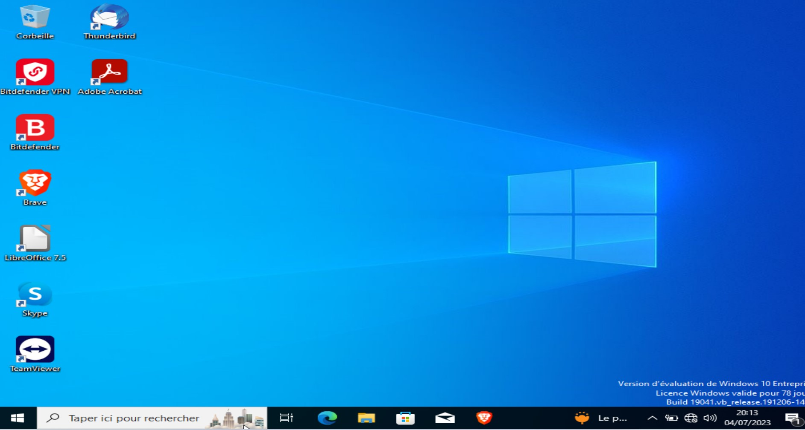
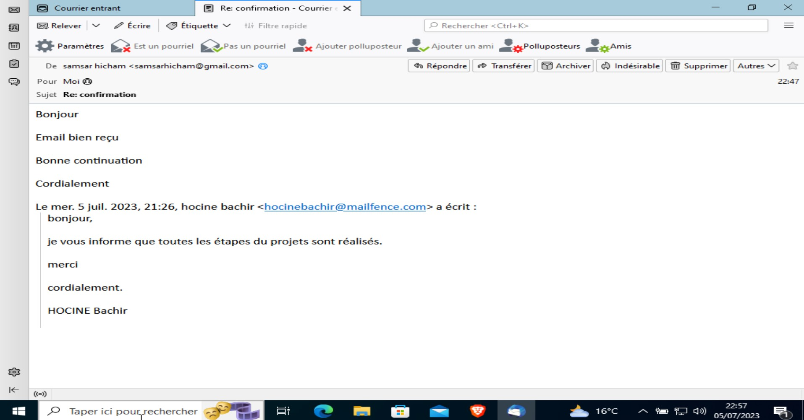
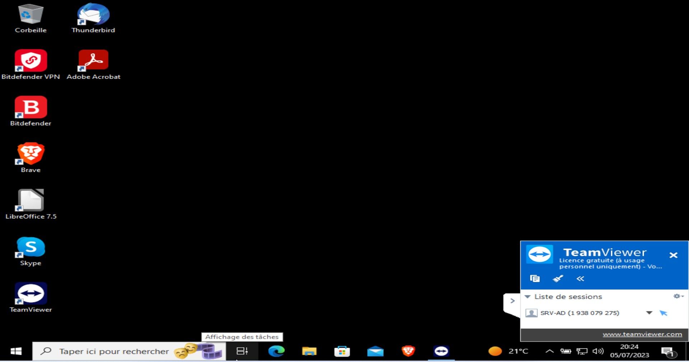

# 🌐 Installation et configuration du réseau d'une PME

## 📋 Contexte du projet
Dans le cadre de ma formation de **Technicien Informatique** (OpenClassrooms), j'ai conçu, simulé et documenté l'architecture réseau complète d'une PME afin d'interconnecter ses postes de travail, d'assurer la communication interne et de permettre la prise en main à distance.

---

## 🛠️ Compétences techniques mobilisées
* **Architecture & Modélisation :** Maîtrise du modèle OSI, découpage réseau et adressage IP.
* **Simulation réseau :** Conception et tests de connectivité sous **Cisco Packet Tracer** (`.pkt`).
* **Environnement utilisateur :** Déploiement des logiciels métiers, configuration d'un client de messagerie et mise en place d'un outil de support à distance (**TeamViewer**).
* **Documentation technique :** Rédaction de la documentation d'exploitation et des procédures utilisateurs.

---

## 📸 Aperçu des réalisations techniques

### Déploiement des logiciels métiers

### Configuration de la messagerie professionnelle

### Mise en place de la prise en main à distance (TeamViewer)

---

## 📂 Livrables complets du projet
* 📊 [Étude du modèle OSI et plan d'adressage (PDF)](Hocine_Bachir_1_ModelOSI_082023.pdf)
* 🔌 [Maquette réseau Cisco Packet Tracer (.pkt)](Hocine_Bachir_2_Réseau_082023.pkt)
* 📖 [Documentation technique complète (PDF)](Hocine_Bachir_6_Documentation_082023.pdf)
